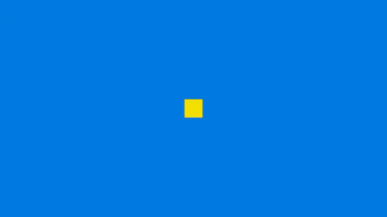
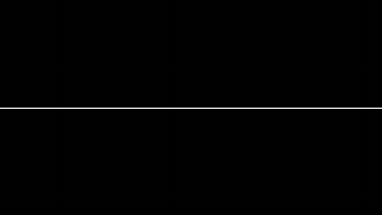
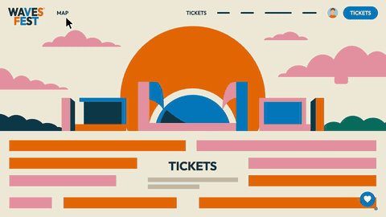
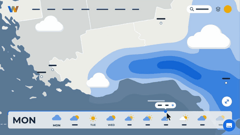
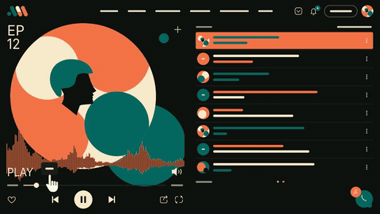
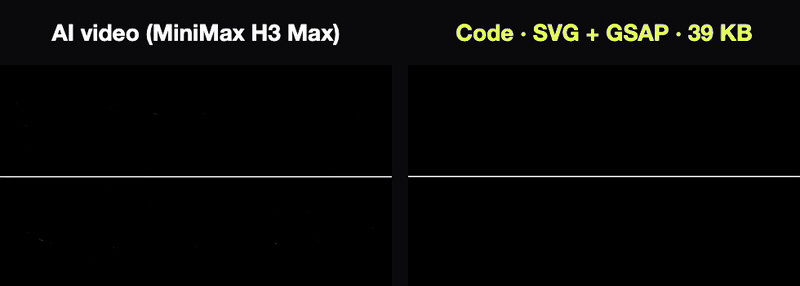

# Motion2Code

A skill that teaches coding agents to rebuild a motion design video as clean, editable code: inline SVG shapes
animated by one GSAP timeline, seekable frame by frame, looping seamlessly, and checked side by side against the
source. For screen recordings of websites and apps it goes one step further and builds the real, interactive site
with GSAP ScrollTrigger. It works with Claude Code, Codex, Cursor, Copilot, Gemini and others.

**See them running live:** [fal-motion-in-code.vercel.app](https://fal-motion-in-code.vercel.app)

| | | |
|---|---|---|
| [](gallery/think-big/index.html) | [](gallery/eye/index.html) | [](gallery/festival-map/index.html) |
| Kinetic type: a square grows into THINK, a bar wipes to BIG, the period becomes a sun. 10 s, 24 KB | Match cuts: an eye opens, its pupil becomes the O of LOOK, a grid of blinking eyes, SEE., NOTICE. 10 s, 40 KB | Festival site replay: the poster folds into a map, a stage card plays, day turns to night. 15 s, 52 KB, [real site](gallery/festival-map/site.html) |
| [](gallery/weather-radar/index.html) | [](gallery/sticker-portfolio/index.html) | [](gallery/podcast-player/index.html) |
| Weather site replay: the slider drags rain bands across the map, TUE turns it sunny, WED strikes lightning. 15 s, 60 KB, [real site](gallery/weather-radar/site.html) | Portfolio replay: a sticker is dragged, the cat unfolds into a grid of cards, HI!, every sticker flies home. 15 s, 56 KB, [real site](gallery/sticker-portfolio/site.html) | Podcast page replay: PLAY, the waveform pulses, transcript bars light up, the cover bounces to the beat. 15 s, 36 KB, [real site](gallery/podcast-player/site.html) |

Each image links to its self-contained `index.html`. Every folder in [`gallery/`](gallery/) also has `compare.html`
(the source and the code side by side, synced frame by frame) and the source clip at 480p. The source videos were
generated with MiniMax H3 Max on fal (fal.ai) and rebuilt by Claude Opus 5.5 with this skill.

## Why



Agents animate blind: they cannot watch the video. Asked to "recreate this clip", they write what they imagine:
the wrong beat at the wrong second, `power1.inOut` where the source snaps and overshoots, colors from memory, words
spelled the way the model misspelled them, and an animation that jumps when it loops. Some quietly embed the
video or trace its frames instead of rebuilding it. This skill closes those gaps:

- **Look before coding.** `study_video.py` turns the clip into what an agent can see: a frame every 0.25 s, the
  frames around every hard change, a contact sheet, the exact flat palette, and whether the source loops.
- **One clock, one contract.** A single GSAP timeline drives everything and the page exposes
  `window.anim.seek(t)`, so any moment can be rendered, compared and tested deterministically.
- **Proof, not "looks right".** `frame_diff.py` puts the source and the code side by side at any time, down to
  every frame of a transition, with a score to rank the worst moments. `compare.html` does the same live.
- **The loop is done in code.** Even when the video does not loop, the last moment returns to the exact opening
  frame; `check_anim.py` measures the seam.
- **Exact frames out.** `render_anim.py` renders through `seek(t)`, frame by frame, so proof videos and GIFs never
  drop or double frames.
- **Vectors at any size.** The source is a 1080p video; the code renders sharp at 4K, 8K, 16K or 32K, weighs tens of
  kilobytes, and stays editable: recolor, retime or rewrite a word in a text editor.
- **Real sites from fake ones.** A video model's "screen recording" becomes a working page: real scroll with
  ScrollTrigger, real buttons, keyboard and mobile support.

## Install

**Claude Code** (plugin marketplace):

```bash
claude plugin marketplace add lovisdotio/motion2code
```

```bash
claude plugin install motion2code@motion2code
```

Or copy the skill: `cp -R skills/motion2code ~/.claude/skills/`.

**Codex, Cursor, Gemini CLI, Copilot and about 70 other agents** (via [skills](https://github.com/vercel-labs/skills)):

```bash
npx skills add lovisdotio/motion2code
```

Or install by hand:
- **Codex:** copy `skills/motion2code` to `~/.agents/skills/`.
- **Cursor:** copy it to `~/.cursor/skills/`, plus the rule in `adapters/cursor/`.
- **Copilot:** `gh skill install lovisdotio/motion2code motion2code`, plus `adapters/copilot/`.
- **Gemini CLI:** `gemini extensions install https://github.com/lovisdotio/motion2code`.
- **Hermes:** copy it to `~/.hermes/skills/`.

**claude.ai:** zip `skills/motion2code` and upload it under Settings > Capabilities > Skills.

**ChatGPT, Gemini Gems and other chat tools:** see [`adapters/`](adapters/).

The scripts need Python 3.9+, ffmpeg, and Playwright for the ones that open a browser
(`uv run --with playwright python ...`, or `pip install playwright && python -m playwright install chromium`).

## Use

Ask naturally: *"Rebuild clip.mp4 as an SVG + GSAP animation that loops"*, or *"turn this app screen recording into
a real site"*. For a full brief, fill in [`prompts/convert-video-prompt.md`](prompts/convert-video-prompt.md).
The agent studies the video, builds the page, then checks it:

```bash
python3 scripts/study_video.py clip.mp4 -o study/
python3 scripts/frame_diff.py clip.mp4 index.html -o diff/
python3 scripts/check_anim.py index.html --runtime
python3 scripts/render_anim.py index.html -o anim.mp4
python3 scripts/side_by_side.py clip.mp4 anim.mp4 -o side_by_side.mp4 --html index.html
```

What the scripts do:
- `study_video.py` saves frames every 0.25 s (named by time), the frames before and after each detected cut, a
  contact sheet, the palette and a loop score of the source in `study.json`.
- `palette.py` prints the exact flat colors of a video or image as hex with their share of the frame.
- `frame_diff.py` writes source | code image pairs at the given times (or every frame of a range), a sheet of all
  pairs, and a difference score per time with the worst five.
- `check_anim.py` checks the page contract, the script allowlist and the absence of embedded raster or video; with
  `--runtime` it also opens the page headless and checks console errors, network requests, the loop seam, that
  `seek` is deterministic, and that the page autoplays.
- `render_anim.py` renders the page frame by frame through `anim.seek` to an mp4, a GIF poster or PNG frames,
  at any `--size`.
- `side_by_side.py` stacks the source and the render into one labelled proof video (landscape or portrait).

To view a gallery entry with its comparison, serve the folder (`python3 -m http.server -d gallery/eye`) and open
`http://127.0.0.1:8000/compare.html`.

## The page contract

```js
window.anim = { tl, duration, seek(t), play(from), pause() }   // seek(t) is a pure function of t
```

- `index.html?t=6.5` freezes at 6.5 s, `?external=1` waits to be driven, no parameter plays and loops.
- `<html data-ready="1">` once fonts are loaded and the first frame is drawn.
- Self-contained: inline SVG, GSAP 3 from cdnjs, flubber from jsdelivr only for morphs, Google Fonts. Nothing else.

## Hard rules

- Use only the given source video: never regenerate it, never embed it, never trace its frames.
- Text exactly as in the source prompt, even when the video misspells it.
- Flat shapes as SVG, colors sampled from the source.
- The GSAP timeline is the single clock.
- The loop is done in code: frame(duration) equals frame(0).
- Every moment is checked against the source, side by side.

## Repository

```text
skills/motion2code/   the skill: SKILL.md, references/, scripts/, templates/
gallery/              six rebuilt clips: index.html, compare.html, source.mp4 (480p), poster.gif, site.html
prompts/              fill-in conversion prompt and advice for source prompts
adapters/             prompts for tools without skill support
tests/                repository checks (every gallery page and template)
.claude-plugin/       Claude Code plugin + marketplace manifests
```

Contributing: see [AGENTS.md](AGENTS.md) for the rules every change must pass.

## License

MIT, Lovis Odin. The gallery source clips were generated with MiniMax H3 Max on fal and are included at 480p for
comparison only.
